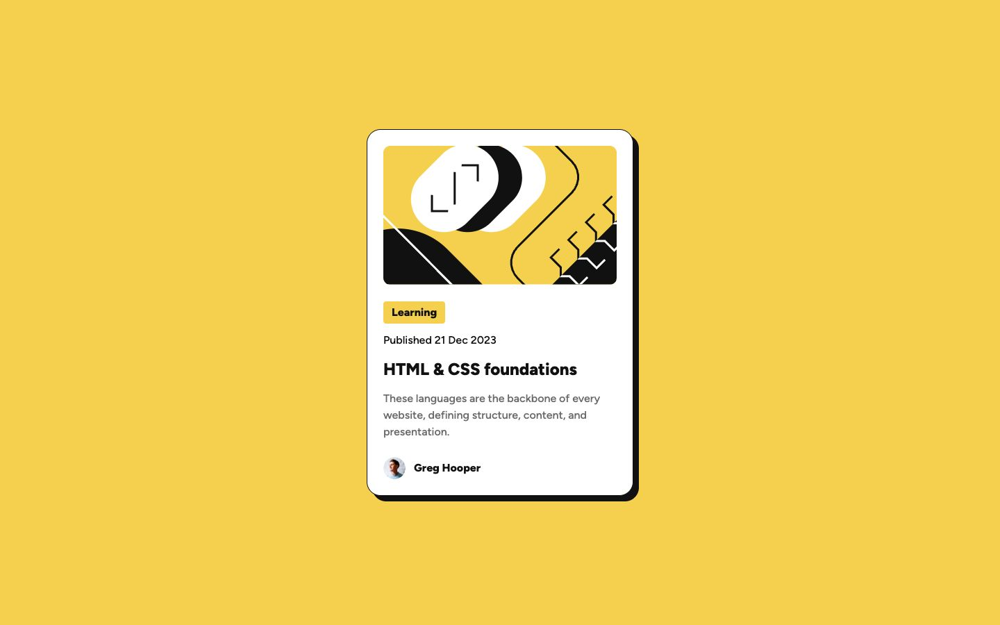

# Frontend Mentor - Blog preview card solution

This is a solution to the [Blog preview card challenge on Frontend Mentor](https://www.frontendmentor.io/challenges/blog-preview-card-ckPaj01IcS). I built a responsive blog preview card whose title opens MDN's introductory HTML and CSS material.

## Table of contents

- [Overview](#overview)
  - [The challenge](#the-challenge)
  - [Screenshot](#screenshot)
  - [Links](#links)
- [My process](#my-process)
  - [Built with](#built-with)
  - [What I learned](#what-i-learned)
  - [Continued development](#continued-development)
- [Run it locally](#run-it-locally)
- [Author](#author)

## Overview

### The challenge

Users should be able to:

- View the card at different screen sizes.
- See the card's shadow grow and its title change color on hover or keyboard focus.
- Follow the title link to MDN's HTML and CSS learning material.

### Screenshot



### Links

- Solution URL: [My Frontend Mentor solution](https://www.frontendmentor.io/solutions/blog-preview-card-with-nextjs-typescript-and-tailwind-rBpF9wfYaI)
- Live Site URL: [Blog preview card](https://blog-preview-card.royeradames.com)

## My process

### Built with

- Next.js 16.3.6 and React 19.2.8
- TypeScript
- Tailwind CSS 4.2.1 and custom CSS
- Semantic HTML, CSS Grid and Flexbox
- Local Figtree font through `next/font/local`
- Playwright and ESLint

### What I learned

I learned to check the Figma interaction states as well as the static frames. The "Card Hover" state grows the shadow from 8 px to 16 px anywhere on the card. I used 24 px spacing between the image, copy and author, and a 20 px title on mobile.

I kept the card as an `article` with a native title link. The link's `::after` element covers the card, so the whole card opens the same destination. CSS handles hover and keyboard focus. Reading the card and following its links work without JavaScript.

I raised the design's 12 and 14 px text to a 16 px minimum. I also used dark gold, `#7a5a00`, for the active title. The design's yellow has only 1.6:1 contrast on white. These choices change the design slightly to keep the text readable.

### Continued development

- I want to extend the width checks beyond 1600 px. The current sweep in `tests/design.spec.ts` covers 320 to 1600 px in 10 px steps.

## Run it locally

Use Node 24. Install dependencies and start the development server:

```sh
npm ci
npm run dev
```

Validation commands:

```sh
npm run lint
npm run typecheck
npm run build
npm test
```

Playwright uses installed Chrome and starts the production server after the build. Its default port is 4327; `PORT` overrides it. The tests cover the desktop, hover and mobile frames, keyboard focus, links without JavaScript, site identity and responsive widths.

The card uses a sample author and date. I disclose this below the card and explain that the title opens MDN learning material. The page collects no data. I use "Blog Preview Card" for both `og:site_name` and WebSite JSON-LD.

The supplied artwork and sample copy come from Frontend Mentor. I include Figtree's [OFL licence](./public/fonts/OFL.txt). Design and source notes are in [reference/SOURCES.md](./reference/SOURCES.md).

## Author

- Website - [Royer Adames](https://royeradames.com)
- Frontend Mentor - [@royeradames](https://www.frontendmentor.io/profile/royeradames)
